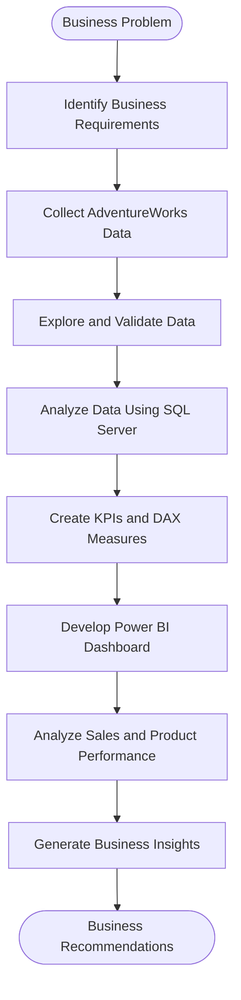

# Project Overview
## Project Workflow Diagram

The following workflow illustrates how raw sales data is transformed into meaningful business insights using SQL Server and Power BI.

### Workflow Explanation

1. **Business Problem:** Identify the need to understand sales and employee performance.
2. **Business Requirements:** Define the business questions and KPIs.
3. **Data Collection:** Use the AdventureWorks dataset.
4. **Data Validation:** Check data quality and consistency.
5. **SQL Analysis:** Analyze sales, products, regions, and employees.
6. **KPI Development:** Create business measures using DAX.
7. **Dashboard Development:** Build interactive Power BI reports.
8. **Business Analysis:** Identify performance trends and gaps.
9. **Recommendations:** Present actionable insights for business decisions.
## 1. Project Title
Sales Analytics & Employee Performance Dashboard

## 2. Project Background
This project uses the AdventureWorksDW sample data warehouse to analyse sales performance, product profitability, customer purchasing behaviour, regional performance, and employee contribution.

The project combines SQL Server analysis with interactive Power BI reporting to turn transactional data into meaningful business information.

## 3. Business Problem
Business decision-makers need reliable information to understand sales performance and identify areas that may require attention.

The key business challenges addressed by this project include:

- Understanding revenue and profitability trends.
- Identifying high-performing and low-performing products.
- Comparing sales performance across territories.
- Understanding customer purchasing behaviour.
- Evaluating employee contribution within reseller sales.
- Checking data quality before using analytical results.

## 4. Business Objectives
- Analyse Internet Sales and Reseller Sales separately.
- Monitor revenue, gross profit, and profit margin.
- Identify product and category performance.
- Compare regional and territory-level performance.
- Analyse employee contribution in reseller sales.
- Validate data quality and analytical calculations.
- Present results through interactive Power BI dashboards.

## 5. Project Stakeholders

The following stakeholder roles are simulated for this portfolio project. They represent potential users of the proposed reporting solution; no actual stakeholder interviews were conducted.

| Stakeholder | Main Information Need |
|---|---|
| Sales Manager | Revenue, profitability, and sales trends |
| Regional Manager | Territory-level performance |
| Product Manager | Product and category performance |
| Senior Management | Overall business performance |
| Business Analyst | Requirements and business validation |
| Data Analyst | Data preparation, SQL analysis, and reporting |

## 6. Project Scope

### In Scope
- Internet and reseller sales analysis.
- Product and category performance.
- Customer purchasing analysis.
- Territory-level reporting.
- Employee contribution analysis for reseller sales.
- KPI reporting and interactive dashboards.
- Data quality validation.

### Out of Scope
- Live business transaction processing.
- Real-time external system integration.
- CRM implementation.
- Automated inventory management.
- Production forecasting or automated business decisions.

## 7. Proposed Solution
Use SQL Server to explore, analyse, and validate the AdventureWorksDW data. Use Power BI to present relevant KPIs, trends, comparisons, and filters through a three-page analytical dashboard.

## 8. Success Criteria
The proposed reporting solution should:

- Present clearly defined business KPIs.
- Separate Internet Sales and Reseller Sales where their metrics differ.
- Allow users to explore relevant performance dimensions.
- Provide understandable and validated reporting.
- Help stakeholders investigate the business questions defined in the project.

## 9. Assumptions and Limitations
- AdventureWorksDW is a sample dataset used for educational and portfolio purposes.
- Stakeholder roles and business needs are simulated.
- No real company stakeholder interviews or production deployment are claimed.
- Findings and recommendations must be supported by validated query results and dashboard calculations.

## 10. Expected Deliverables
- SQL analysis scripts.
- Three-page Power BI dashboard.
- Stakeholder analysis.
- Business Requirements Document (BRD).
- Functional Requirements Document (FRD).
- User stories and acceptance criteria.
- Process documentation.
- Requirements Traceability Matrix (RTM).
- User Acceptance Testing (UAT) test cases.
- Evidence-based business recommendations.
