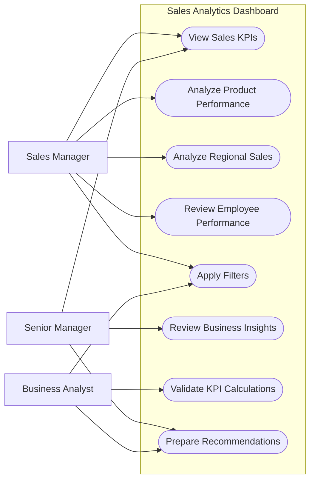

# Use Cases and User Stories
## Sales Analytics & Employee Performance Dashboard

**Document Type:** Use Cases and User Stories  
**Project:** Sales Analytics & Employee Performance Dashboard  
**Version:** 1.0  
**Status:** Proposed – Portfolio Case Study  
**Prepared By:** Business Analyst (Simulated Project Role)

---

## 1. Introduction

This document describes how different business users interact with the proposed Sales Analytics & Employee Performance Dashboard.

It includes user stories and use cases that translate business requirements into practical user activities.

The stakeholder roles and scenarios are simulated for this portfolio project.

## 2. User Stories
## Use Case Diagram

The following use case diagram illustrates how business users interact with the Sales Analytics Dashboard to monitor and analyze business performance.

### Actors
- **Sales Manager:** Reviews sales, product, and regional performance.
- **Senior Manager:** Monitors overall business performance and profitability.
- **Business Analyst:** Analyzes data, validates KPIs, and prepares business insights.

### Use Case Diagram

### Use Case Explanation

| Actor | Interaction | Business Purpose |
|---|---|---|
| Sales Manager | View Sales KPIs | Monitor sales performance |
| Sales Manager | Analyze Products | Identify top and low performers |
| Sales Manager | Analyze Regions | Compare regional sales |
| Senior Manager | Review Insights | Understand overall performance |
| Business Analyst | Validate KPIs | Ensure calculation accuracy |
| Business Analyst | Prepare Recommendations | Support business decisions |

### Expected Outcome

The use case diagram provides a clear understanding of user roles, dashboard interactions, and the business value of each feature.

**Portfolio Note:** These actors and interactions are proposed for this simulated portfolio project. They do not represent confirmed users or formally gathered stakeholder requirements.

### US-01: View Overall Sales Performance

**As a** Senior Manager,  
**I want** to view overall sales KPIs,  
**So that** I can understand the company's sales performance.

**Related Requirement:** BR-01 / FR-01

### US-02: Analyze Sales Trends

**As a** Sales Manager,  
**I want** to view sales trends over time,  
**So that** I can identify increases and decreases in sales performance.

**Related Requirement:** BR-02 / FR-02

### US-03: Identify Top-Performing Products

**As a** Product Manager,  
**I want** to view products ranked by revenue,  
**So that** I can identify the products contributing the most to sales.

**Related Requirement:** BR-03 / FR-03

### US-04: Compare Regional Sales

**As a** Regional Manager,  
**I want** to compare sales performance across regions,  
**So that** I can identify high-performing and low-performing territories.

**Related Requirement:** BR-04 / FR-04

### US-05: Analyze Employee-Related Sales

**As a** Sales Manager,  
**I want** to view reseller sales performance by employee,  
**So that** I can understand employee-related sales results.

**Related Requirement:** BR-05 / FR-05

### US-06: Filter Dashboard Information

**As a** Dashboard User,  
**I want** to filter reports by relevant dimensions,  
**So that** I can focus on the specific data I need.

**Related Requirement:** BR-06 / FR-06

### US-07: Review Visual Reports

**As a** Business Stakeholder,  
**I want** to view sales information through clear visualizations,  
**So that** I can understand business performance easily.

**Related Requirement:** BR-07 / FR-07

## 3. Use Cases

### UC-01: View Overall Sales Performance

**Primary Actor:** Senior Manager

**Precondition:** The user has opened the dashboard.

**Main Flow:**
1. User opens the Executive Overview page.
2. System displays available KPI cards.
3. User reviews revenue, orders, and other relevant metrics.
4. User interprets the overall sales performance.

**Expected Outcome:** User can understand overall sales performance using the displayed KPIs.

### UC-02: Identify Top Five Products

**Primary Actor:** Product Manager

**Precondition:** Product sales data is available in the dashboard.

**Main Flow:**
1. User opens the Product Performance page.
2. System displays product-wise revenue.
3. User views the product ranking.
4. User identifies the top five products by revenue.
5. User applies available filters if required.
6. System updates the relevant visuals.

**Expected Outcome:** User can identify the five products generating the highest revenue within the selected filters.

### UC-03: Compare Regional Sales

**Primary Actor:** Regional Manager

**Precondition:** Regional sales data is available.

**Main Flow:**
1. User opens the relevant sales analysis page.
2. User views regional or territory-wise sales.
3. User compares the available regions.
4. User identifies higher- and lower-performing regions.

**Expected Outcome:** User can compare regional sales performance.

### UC-04: Analyze Sales Trends

**Primary Actor:** Sales Manager

**Precondition:** Historical sales data is available.

**Main Flow:**
1. User opens the Sales Trends page.
2. System displays sales trends over time.
3. User selects a relevant date period.
4. System updates the visualizations.
5. User reviews the sales trend.

**Expected Outcome:** User can understand changes in sales over time.

### UC-05: Apply Dashboard Filters

**Primary Actor:** Dashboard User

**Precondition:** Dashboard filters are available.

**Main Flow:**
1. User opens a dashboard page.
2. User selects a relevant filter.
3. System applies the selected filter.
4. Relevant KPI cards and visualizations update.
5. User reviews the filtered results.

**Expected Outcome:** User can analyze a selected portion of the available business data.

## 4. Acceptance Criteria for User Stories

| User Story | Acceptance Criteria |
|---|---|
| US-01 | Relevant KPI cards display validated values. |
| US-02 | Users can view historical sales trends. |
| US-03 | Users can identify the top five products by revenue. |
| US-04 | Users can compare available regions. |
| US-05 | Employee-related reseller sales results are visible. |
| US-06 | Relevant visuals respond correctly to filters. |
| US-07 | Reports display clear labels and understandable visualizations. |

## 5. Business Value

The proposed use cases and user stories help:

- Connect dashboard functionality to business needs.
- Make requirements easier for developers and testers to understand.
- Improve communication between business and technical teams.
- Support requirement validation and testing.
- Keep development focused on business value.

## 6. Assumptions and Limitations

- Stakeholder roles are simulated.
- User stories represent proposed business needs.
- Use cases describe expected interactions, not independently verified system behaviour.
- Actual implementation must be validated against the existing Power BI dashboard.
- Available functionality depends on the AdventureWorks dataset and implemented dashboard features.

## 7. Conclusion

This document describes how business users are expected to interact with the Sales Analytics & Employee Performance Dashboard.

The user stories explain what users need and why, while the use cases describe the steps users follow to achieve their goals.

These documents provide a foundation for requirement validation and test case development.
