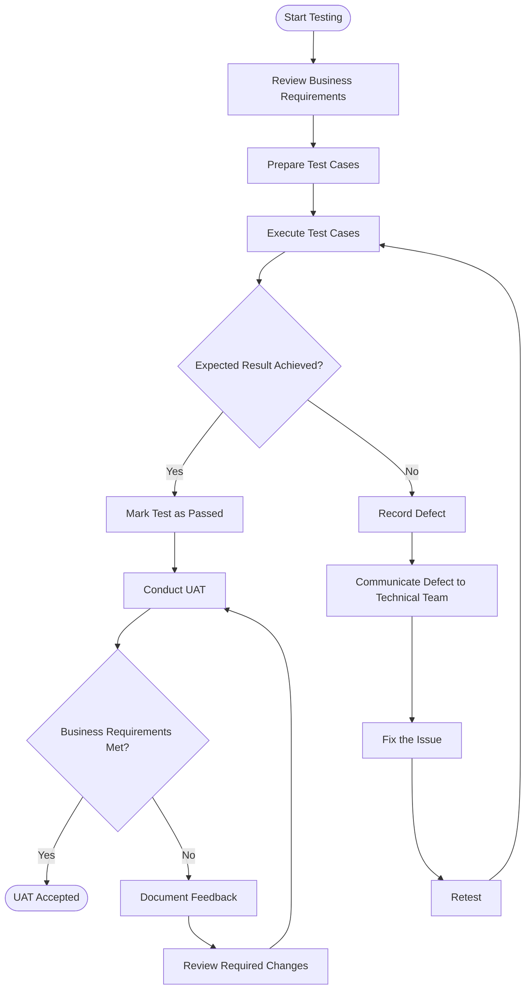

# Test Cases & User Acceptance Testing (UAT)

## 1. Introduction

Testing and User Acceptance Testing (UAT) help verify whether a business solution works correctly and meets business requirements.

This document defines proposed test cases and a UAT approach for the Sales Analytics & Employee Performance Dashboard.

## 2. Testing Objectives

- Verify the accuracy of KPI calculations.
- Check whether dashboard filters work correctly.
- Validate product and regional sales analysis.
- Verify employee and reseller performance calculations.
- Identify and document defects.
- Confirm that dashboard functionality supports business requirements.

## 3. Testing Types

| Testing Type | Purpose | Example |
|---|---|---|
| Functional Testing | Verify system functionality | Check whether date filters work |
| Data Validation Testing | Verify data accuracy | Compare SQL revenue with Power BI revenue |
| Integration Testing | Check data connections | Verify SQL Server data is reflected in Power BI |
| Regression Testing | Ensure changes do not break existing features | Recheck KPIs after a measure update |
| User Acceptance Testing | Verify business needs are met | Check whether a Sales Manager can analyze product performance |

## 4. Test Cases

### Test Case 1: Verify Total Revenue

| Field | Details |
|---|---|
| Test Case ID | TC-001 |
| Test Scenario | Verify Total Revenue KPI |
| Preconditions | Sales data is available |
| Test Steps | Open dashboard and check Total Revenue |
| Expected Result | Revenue matches the validated source calculation |
| Actual Result | To be recorded during testing |
| Status | Not Executed |

### Test Case 2: Verify Date Filter

| Field | Details |
|---|---|
| Test Case ID | TC-002 |
| Test Scenario | Verify date slicer |
| Preconditions | Dashboard contains a date filter |
| Test Steps | Select a year and observe KPI changes |
| Expected Result | Relevant visuals update according to the selected year |
| Actual Result | To be recorded during testing |
| Status | Not Executed |

### Test Case 3: Verify Top 5 Products

| Field | Details |
|---|---|
| Test Case ID | TC-003 |
| Test Scenario | Verify top five products by revenue |
| Preconditions | Product revenue data is available |
| Test Steps | Apply the Top 5 product ranking and compare with SQL |
| Expected Result | The five highest-revenue products are displayed correctly |
| Actual Result | To be recorded during testing |
| Status | Not Executed |

### Test Case 4: Verify Regional Sales

| Field | Details |
|---|---|
| Test Case ID | TC-004 |
| Test Scenario | Verify regional sales performance |
| Preconditions | Regional sales data is available |
| Test Steps | Compare regional revenue in Power BI with SQL |
| Expected Result | Regional revenue matches the validated SQL results |
| Actual Result | To be recorded during testing |
| Status | Not Executed |

### Test Case 5: Verify Employee Performance

| Field | Details |
|---|---|
| Test Case ID | TC-005 |
| Test Scenario | Verify employee and reseller sales performance |
| Preconditions | Reseller sales data and employee relationships are available |
| Test Steps | Review employee-wise reseller revenue and compare with SQL |
| Expected Result | Employee performance values match the validated source calculation |
| Actual Result | To be recorded during testing |
| Status | Not Executed |

## 5. Testing Lifecycle Diagram

The following diagram illustrates the proposed testing lifecycle for the Sales Analytics & Employee Performance Dashboard.

### Testing Lifecycle Explanation

1. Review business requirements.
2. Prepare test cases with expected results.
3. Execute test cases.
4. Compare actual results with expected results.
5. Document defects when results do not match.
6. Coordinate issue resolution and retest.
7. Conduct UAT to check business requirements.
8. Record business acceptance or feedback.

## 6. User Acceptance Testing (UAT)

UAT verifies whether the dashboard meets business users' needs.

### UAT Scenarios

| UAT ID | Business Scenario | Expected Outcome |
|---|---|---|
| UAT-001 | Sales Manager views overall sales | Can understand overall sales performance |
| UAT-002 | User analyzes product performance | Can identify high- and low-revenue products |
| UAT-003 | User filters sales by region | Can compare regional performance |
| UAT-004 | Senior Manager reviews profitability | Can understand revenue and gross profit |
| UAT-005 | Manager reviews employee performance | Can analyze reseller sales contribution by employee |

## 7. Difference Between QA and UAT

| Quality Assurance (QA) | User Acceptance Testing (UAT) |
|---|---|
| Checks whether the solution works correctly | Checks whether the solution meets business needs |
| Usually performed by testers or QA teams | Usually performed by business users |
| Focuses on technical and functional quality | Focuses on business acceptance |
| Example: Does the revenue filter calculate correctly? | Example: Can a Sales Manager use the dashboard to understand sales performance? |

## 8. Defect Reporting Template

| Field | Example |
|---|---|
| Defect ID | BUG-001 |
| Related Test Case | TC-002 |
| Defect Description | Date filter does not update revenue KPI |
| Expected Result | Revenue should update based on selected year |
| Actual Result | Revenue remains unchanged |
| Severity | Medium |
| Status | Open |

## 9. Business Analyst Responsibilities

- Understand and review business requirements.
- Prepare and review test scenarios.
- Define expected business outcomes.
- Coordinate with QA and technical teams.
- Document defects and requirement gaps.
- Support UAT activities.
- Collect business feedback.
- Track issues until resolution.

## 10. Conclusion

Testing and UAT help ensure that a dashboard is accurate, reliable, and aligned with business requirements. A structured testing approach improves confidence in business reporting and supports better decisions.

**Portfolio Note:** This document contains proposed test cases and a simulated UAT approach for a learning project. The test cases have not been presented as executed, and no actual stakeholder acceptance or formal UAT approval is claimed.
