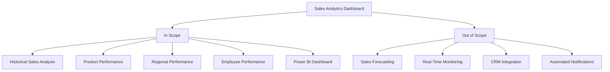
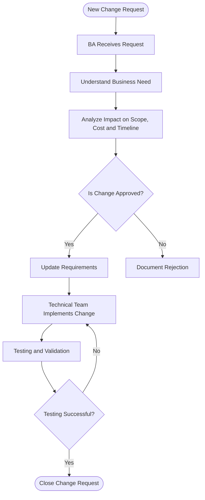

# Change Request & Scope Management

## 1. Introduction

Scope Management defines what is included and excluded from a project. It helps prevent unnecessary changes and ensures that the project stays aligned with business objectives, budget, timelines, and resources.

This document explains how change requests can be evaluated and managed for the Sales Analytics & Employee Performance Dashboard.

## 2. Project Scope

### In Scope
- Historical sales data analysis.
- Total revenue, total orders, and gross profit calculations.
- Top-performing and low-performing product analysis.
- Regional sales performance analysis.
- Employee and reseller sales performance analysis.
- Interactive Power BI dashboards.
- Business insights and recommendations.

### Out of Scope
- Future sales forecasting.
- Real-time sales monitoring.
- Customer relationship management.
- Automated email notifications.
- External business application integration.

### Scope Diagram

## 3. What Is Change Request Management?

Change Request Management is the process of receiving, reviewing, evaluating, approving, and tracking changes requested during a project.

A Business Analyst evaluates whether a proposed change:
- Supports business objectives.
- Affects the existing project scope.
- Requires additional time or resources.
- Creates technical dependencies.
- Should be approved, rejected, or postponed.

## 4. Change Request Management Flowchart

## 5. Example Business Scenario

**Scenario:** A Sales Manager requests a monthly sales forecasting feature.

However, the
