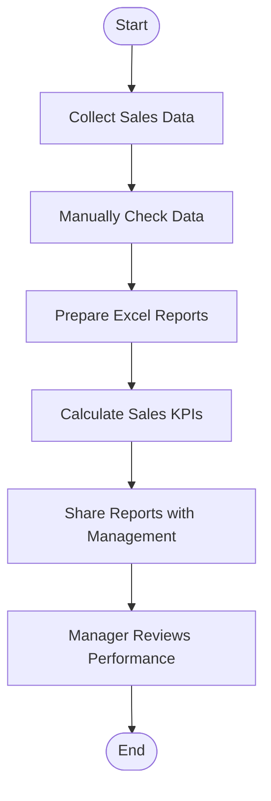
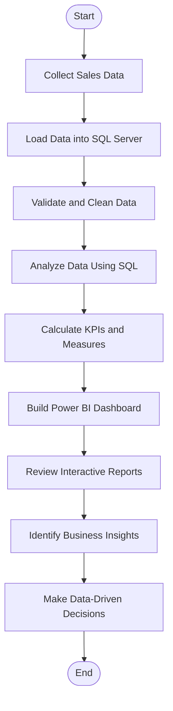

# Business Process Modelling

The process helps business users:
- Monitor sales performance.
- Identify top-performing products.
- Understand regional sales trends.
- Evaluate employee and reseller performance.
- Make data-driven decisions.

## 3. Current Business Process (As-Is)

The As-Is process represents how the reporting workflow currently operates in this simulated scenario.

### As-Is Process Diagram

### Challenges in the As-Is Process

- Manual reporting takes time.
- Data errors may affect reporting accuracy.
- Comparing regional and product performance can be difficult.
- Repeated report preparation reduces efficiency.
- Business insights may not be available quickly.

## 4. Proposed Business Process (To-Be)

The To-Be process represents a proposed improved reporting workflow using SQL Server and Power BI.

### To-Be Process Diagram

## 5. As-Is vs To-Be Comparison

| Area | As-Is Process | To-Be Process |
|---|---|---|
| Data preparation | Manual | Structured SQL workflow |
| Data validation | Manual checking | Defined validation checks |
| Reporting | Excel reports | Power BI dashboard |
| KPI calculation | Manual calculations | Defined SQL and DAX measures |
| Analysis | Limited comparisons | Interactive analysis |
| Decision-making | Based on static reports | Supported by dashboard insights |

## 6. Expected Business Benefits

- Reduce repetitive manual reporting work.
- Improve consistency of KPI calculations.
- Make sales performance easier to monitor.
- Identify product and regional performance patterns.
- Support faster, evidence-based decisions.

## 7. Business Analyst Responsibilities

- Understand the existing business workflow.
- Identify process challenges and bottlenecks.
- Gather business requirements.
- Model the current and proposed workflows.
- Communicate process improvements to stakeholders.
- Validate whether the proposed process meets business needs.

## 8. Conclusion

Business Process Modelling helps translate business problems into clear workflows. Comparing As-Is and To-Be processes helps identify improvement opportunities and communicate the proposed solution.

**Portfolio Note:** The As-Is workflow represents a simulated manual reporting scenario, and the To-Be workflow represents the proposed process for this portfolio project. These are illustrative process models, not findings from an actual organization's operations.
