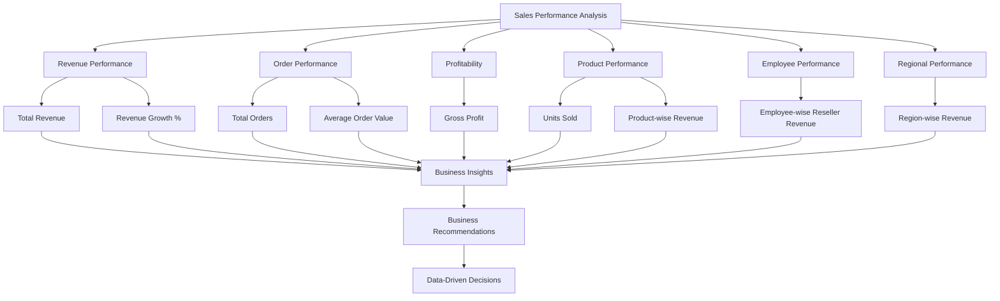

# KPI Analysis & Business Recommendations

## 1. Introduction

KPI Analysis helps businesses measure performance against their objectives. A Business Analyst studies KPIs, identifies trends, investigates performance gaps, and recommends improvements.

This document focuses on the Sales Analytics & Employee Performance Dashboard.

## 2. Business Objectives

- Monitor overall sales performance.
- Identify high-performing and low-performing products.
- Evaluate regional sales performance.
- Analyze employee and reseller performance.
- Support data-driven business decisions.

## 3. Key Performance Indicators (KPIs)

| KPI | Definition | Business Purpose |
|---|---|---|
| Total Revenue | Total sales amount | Measure overall sales |
| Total Orders | Distinct sales order count | Monitor order volume |
| Gross Profit | Revenue minus product cost | Measure profitability |
| Units Sold | Total quantity sold | Understand product demand |
| Average Order Value | Revenue divided by distinct orders | Measure average order value |
| Revenue Growth % | Percentage change in revenue over time | Monitor sales growth |

## KPI Relationship Diagram

The following diagram illustrates how key performance indicators support different areas of business analysis and decision-making.

### Diagram Explanation

1. **Revenue Performance:** Measures total revenue and revenue growth.
2. **Order Performance:** Measures order volume and average order value.
3. **Profitability:** Helps evaluate gross profit.
4. **Product Performance:** Identifies product revenue and units sold.
5. **Employee Performance:** Evaluates employee-wise reseller revenue.
6. **Regional Performance:** Compares revenue across regions.
7. **Business Insights:** Combines KPI findings to identify trends and gaps.
8. **Business Recommendations:** Converts findings into possible business actions.

### Business Value

This KPI relationship helps management understand how individual performance metrics contribute to overall business performance and supports evidence-based decisions.
## 4. KPI Analysis

### Revenue Analysis
- Monitor revenue trends over time.
- Identify periods with higher or lower sales.
- Compare performance across regions.

### Product Performance
- Identify top-performing products by revenue.
- Identify products with lower revenue.
- Compare product categories to understand sales contribution.

### Employee Performance
- Compare reseller sales performance by employee.
- Identify employees associated with higher sales.
- Investigate differences in sales contribution.

## 5. Business Questions

1. Which products generate the highest revenue?
2. Which products contribute the least revenue?
3. Which regions generate the most sales?
4. How does revenue change over time?
5. Which employees contribute the most reseller revenue?
6. Are sales and profitability moving in the same direction?

## 6. Business Recommendations

| Business Finding to Validate | Recommended Business Action |
|---|---|
| A small number of products generate most revenue | Monitor inventory and availability of high-revenue products |
| Some products show consistently low revenue | Investigate pricing, demand, and product positioning |
| Regional revenue varies | Review regional sales strategies |
| Employee sales contribution varies | Review workload, territory, and sales support |
| Revenue increases but profit does not | Investigate product costs and discounting |

## 7. Expected Business Benefits

- Better sales performance monitoring.
- Improved product-level decisions.
- More focused regional strategies.
- Better understanding of employee sales contribution.
- More informed business planning.

## 8. Business Analyst Responsibilities

- Define relevant KPIs with business users.
- Understand KPI calculation logic.
- Analyze trends and performance gaps.
- Validate calculations against source data.
- Communicate insights clearly.
- Recommend actions supported by evidence.

## 9. Conclusion

KPI analysis helps transform raw data into business insights. By connecting performance metrics with business objectives, a Business Analyst can help management identify opportunities and make informed decisions.

**Portfolio Note:** This document presents proposed KPI analysis and recommendations for a simulated portfolio project. Recommendations should be validated against actual dashboard findings before being presented as confirmed business conclusions.
