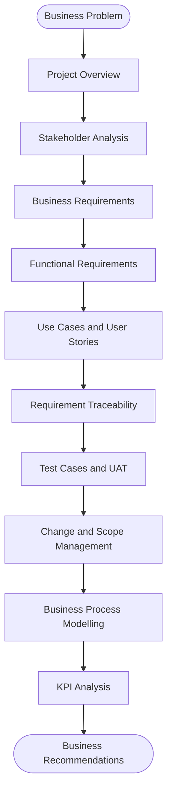

# 💼 Business Analysis Portfolio
## Sales Analytics & Employee Performance Dashboard

## 📌 Project Overview

This Business Analysis portfolio demonstrates how business problems can be translated into structured requirements, functional specifications, process workflows, and actionable business recommendations.

The case study is based on a Sales Analytics & Employee Performance Dashboard developed using the AdventureWorks sample dataset, SQL Server, and Power BI.

It demonstrates the Business Analyst's role in understanding business needs, defining KPIs, documenting requirements, analyzing processes, and supporting data-driven decisions.

## 🎯 Business Problem

Businesses need a clear understanding of their sales performance, product contribution, regional trends, and employee-wise reseller performance.

This project explores how a structured analytics solution can help business users:

- Monitor sales performance.
- Identify high- and low-performing products.
- Understand regional sales contribution.
- Analyze employee and reseller performance.
- Track business KPIs.
- Support informed decision-making.

## 📂 Business Analysis Documentation

The following documents demonstrate the Business Analysis lifecycle.

| No. | Document | Description |
|---|---|---|
| 01 | [Project Overview](01_Project_Overview.md) | Business problem, objectives, and scope |
| 02 | [Stakeholder Analysis](02_Stakeholder_Analysis.md) | Stakeholder roles and responsibilities |
| 03 | [Business Requirements Document](03_Business_Requirements_Document.md) | Business requirements and objectives |
| 04 | [Functional Requirements Document](04_Functional_Requirements_Document.md) | Functional specifications |
| 05 | [Use Cases & User Stories](05_Use_Cases_and_User_Stories.md) | User needs and interactions |
| 06 | [Requirement Traceability Matrix](06_Requirement_Traceability_Matrix.md) | Requirement tracking |
| 07 | [Test Cases & UAT](07_Test_Cases_and_UAT.md) | Testing scenarios and acceptance approach |
| 08 | [Change Request & Scope Management](08_Change_Management.md) | Scope and change evaluation |
| 09 | [Business Process Modelling](09_Business_Process_Modeling.md) | As-Is and To-Be workflows |
| 10 | [KPI Analysis & Business Recommendations](10_KPI_Analysis_and_Business_Recommendations.md) | KPI analysis and recommendations |

## 🔄 Business Analysis Lifecycle

## 📊 Key Business KPIs

| KPI | Business Purpose |
|---|---|
| Total Revenue | Monitor sales performance |
| Total Orders | Understand order volume |
| Gross Profit | Evaluate profitability |
| Units Sold | Measure product demand |
| Average Order Value | Understand average order value |
| Revenue Growth % | Monitor sales growth |

## 🛠️ Tools & Technologies

- **SQL Server:** Data exploration and analysis.
- **Power BI:** Interactive dashboard reporting.
- **DAX:** KPI calculations.
- **Excel:** Data analysis and reporting concepts.
- **GitHub:** Documentation and version control.
- **Mermaid:** Business process and workflow diagrams.

## 💡 Business Analysis Skills Demonstrated

- Business problem identification.
- Stakeholder analysis.
- Business and functional requirements.
- BRD and FRD documentation.
- User stories and use cases.
- Requirement traceability.
- Test case design and UAT planning.
- Scope and change management.
- Business process modelling.
- KPI analysis and business recommendations.

## 🎯 Project Outcomes

This case study demonstrates how a Business Analyst can connect business objectives with data analysis and reporting solutions.

It showcases structured documentation, analytical thinking, requirement management, process understanding, and business communication.

## 👩‍💻 About the Author

Aspiring Business Analyst with a background in Information Technology and practical exposure to SQL Server, Power BI, Excel, Python, and business analytics projects.

Interested in translating business requirements into meaningful insights and supporting data-driven decision-making.

## ⚠️ Disclaimer

This is a simulated portfolio case study created for learning and professional demonstration. Stakeholder roles, business scenarios, requirements, and proposed workflows are illustrative and do not represent an actual organization's approved project documentation or formal stakeholder acceptance.

---

**Author:** Simran Vishwakarma  
**GitHub:** [Simmii-19](https://github.com/Simmii-19)
