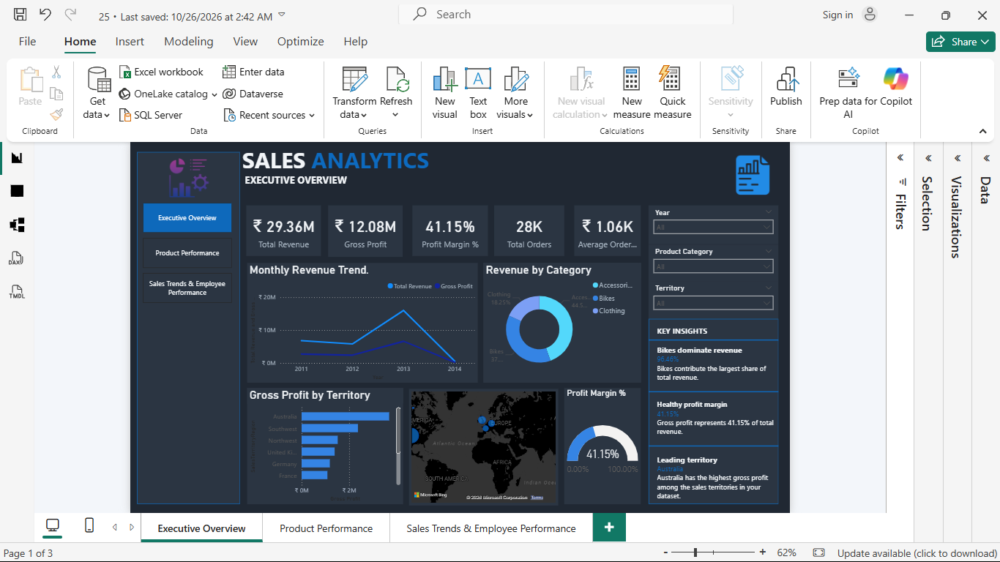

<div align="center">

# Sales Analytics & Employee Performance Dashboard

### End-to-End Business Intelligence Project | SQL Server • Power BI • DAX

[](https://www.microsoft.com/sql-server)
[](https://powerbi.microsoft.com/)
[](https://learn.microsoft.com/dax/)
[](https://learn.microsoft.com/power-query/)
[](https://learn.microsoft.com/sql/samples/adventureworks-install-configure)

**Developed by [Simran Vishwakarma](https://github.com/Simmii-19)**

[View Repository](https://github.com/Simmii-19/Sales-Analytics-Employee-Performance-Dashboard) |
[Explore SQL](./SQL/) |
[Download Power BI Report](./Sales_Analytics_Dashboard.pbix)

</div>

---

## 1. Executive Summary

The **Sales Analytics & Employee Performance Dashboard** is an end-to-end Business Intelligence project developed using Microsoft SQL Server, Power BI, DAX, and the AdventureWorksDW sample database.

The project focuses on analysing sales performance, product profitability, customer purchasing behaviour, regional performance, and employee contribution.

SQL Server is used for database exploration, analytical querying, and data quality validation, while Power BI transforms the analytical results into interactive dashboards that support business reporting and decision-making.

The analysis covers two distinct sales channels:

- **Internet Sales:** Online sales performance and customer purchasing behaviour.
- **Reseller Sales:** Reseller revenue, profitability, and employee performance.

The two sales channels are analysed separately wherever their business definitions and metrics differ.

## 2. Business Problem

Organisations generate large volumes of transactional sales data, but raw data alone does not provide meaningful business insights.

Decision-makers need reliable answers to questions such as:

- Which products and categories generate the highest revenue?
- How does profitability vary across products and territories?
- How are customer purchasing patterns changing?
- Which sales channels contribute to business performance?
- Which employees generate the highest reseller revenue?
- What data quality issues could affect analytical accuracy?

This project addresses these questions through SQL-based analysis and interactive Power BI reporting.

## 3. Business Objectives

1. Explore and understand the AdventureWorksDW data warehouse.
2. Analyse Internet Sales and Reseller Sales separately.
3. Evaluate revenue, gross profit, and profit margins.
4. Identify top-performing products and product categories.
5. Analyse customer purchasing behaviour and segmentation.
6. Examine regional and territory-level sales performance.
7. Evaluate reseller revenue and employee contribution.
8. Perform data quality and validation checks.
9. Develop interactive dashboards for business performance monitoring.

## 4. Technology Stack

| Technology | Application |
|---|---|
| Microsoft SQL Server | Database exploration, querying and validation |
| AdventureWorksDW | Sample data warehouse |
| SQL | Business analysis, aggregations, joins, CTEs and window functions |
| Microsoft Power BI | Interactive dashboards and reporting |
| DAX | KPI calculations and business measures |
| Power Query | Power BI data connection and preparation environment |

## 5. Repository Structure

```text
Sales-Analytics-Employee-Performance-Dashboard/
│
├── SQL/
│   ├── 01_Data_Exploration.sql
│   ├── 02_Sales_Analysis.sql
│   ├── 03_Product_Employee_Analysis.sql
│   ├── 04_Data_Quality_Analysis.sql
│   └── 05_Advanced_SQL_Views.sql
│
├── Screenshots/
│   ├── Executive_Overview.png
│   ├── Product_Performance.png
│   └── Employee_Performance.png
│
├── Sales_Analytics_Dashboard.pbix
│
└── README.md
```

## 6. SQL Analysis

The SQL analysis is divided into five scripts, covering database exploration, sales performance, product and employee analysis, data quality, and advanced analytical queries.

### 01. Data Exploration

**File:** `01_Data_Exploration.sql`

Analysis includes:

- Database and table exploration.
- Column and data type inspection.
- Record count analysis.
- Revenue and gross profit calculations.
- Product category analysis.
- Territory-level analysis.

**Objective:** Understand the database structure and identify the data required for subsequent analysis.

### 02. Sales Analysis

**File:** `02_Sales_Analysis.sql`

Analysis includes:

- Monthly and yearly revenue trends.
- Year-over-year revenue growth.
- Customer analysis.
- Average Order Value.
- Discount analysis.
- Regional sales performance.

**Objective:** Understand sales trends, customer purchasing patterns, and regional performance.

### 03. Product & Employee Analysis

**File:** `03_Product_Employee_Analysis.sql`

Analysis includes:

- Product revenue analysis.
- Product profitability.
- Top-performing product identification.
- Employee revenue analysis.
- Employee ranking and performance comparison.

**Objective:** Identify product performance drivers and evaluate employee contribution within the relevant sales channel.

### 04. Data Quality Analysis

**File:** `04_Data_Quality_Analysis.sql`

Validation includes:

- Missing-value checks.
- Duplicate detection.
- Invalid-value checks.
- Referential integrity validation.
- Sales and profit validation.

**Objective:** Assess data reliability before using the results for business reporting.

### 05. Advanced SQL Views

**File:** `05_Advanced_SQL_Views.sql`

Analysis includes:

- Reusable SQL views.
- Customer segmentation.
- Running revenue totals.
- Month-over-month revenue analysis.
- Product ranking using `DENSE_RANK()`.

**Objective:** Organise reusable analytical logic and demonstrate advanced SQL techniques.

### SQL Concepts Demonstrated

| SQL Concept | Analytical Application |
|---|---|
| SELECT and WHERE | Data retrieval and filtering |
| GROUP BY | Aggregated business reporting |
| JOIN | Combining related warehouse tables |
| Aggregate Functions | Revenue, profit and quantity calculations |
| CTEs | Organising analytical queries |
| Window Functions | Ranking and period-based analysis |
| DENSE_RANK() | Product ranking |
| SQL Views | Reusable analytical datasets |
| Data Validation | Checking data reliability |

## 7. Power BI Dashboard

The Power BI report contains three analytical pages designed around different business reporting requirements.

### Page 1: Executive Overview



**Business Objective:** Monitor overall sales performance and profitability.

**Visible KPIs:**

- Total Revenue
- Gross Profit
- Profit Margin %
- Total Orders
- Average Order Value

**Visualisations:**

- Revenue and Gross Profit Trend
- Revenue by Product Category
- Gross Profit by Territory
- Geographic Sales Distribution
- Profit Margin Gauge
- Interactive Year, Product Category and Territory Filters
- Key Business Insights

**Business Questions:**

- What is the overall revenue and profitability?
- How does revenue change over time?
- Which product categories contribute to revenue?
- Which territories generate higher gross profit?
- What does the current profit margin indicate?

### 2. Product Performance


**Business Objective:** Evaluate product-level performance and category contribution.

**Visible KPIs:**

- Products Sold
- Total Revenue
- Gross Profit
- Profit Margin %

**Visualisations:**

- Top 10 Products by Revenue
- Product Performance Details
- Revenue by Product Category
- Product-level revenue and gross profit comparison
- Year, Product Category and Product Subcategory Filters

**Business Questions:**

- Which products generate the highest revenue?
- How does gross profit vary across products?
- Which categories contribute most to revenue?
- Which products should be investigated for profitability?

### 3. Sales Trends & Employee Performance


**Business Objective:** Analyse reseller sales trends and employee contribution.

**Visible KPIs:**

- Reseller Revenue
- Reseller Gross Profit
- Reseller-related summary metrics

**Visualisations:**

- Monthly Reseller Revenue Trend
- Top 10 Employees by Revenue
- Employee Gross Profit Analysis
- Employee Performance Details

**Business Questions:**

- How does reseller revenue change over time?
- Which employees generate the highest reseller revenue?
- How does gross profit contribution vary by employee?
- How can employee performance be compared?

**Note:** Employee performance on this page should be interpreted in the context of the reseller analysis displayed, rather than assumed to represent all sales channels.

## 8. DAX Measures & KPI Definitions

The Power BI report includes measures such as:

| DAX Measure | Business Definition |
|---|---|
| Total Revenue | Revenue generated under the selected filter context |
| Gross Profit | Revenue less the relevant cost basis |
| Profit Margin % | Gross profit expressed as a percentage of revenue |
| Total Orders | Order count based on the measure's counting logic |
| Average Order Value | Revenue divided by the relevant order count |
| Customer Count | Number of customers under the defined filter context |
| Total Units Sold | Total quantity of products sold |
| Revenue Growth % | Revenue change relative to a comparison period |
| Reseller Revenue | Revenue generated through reseller sales |
| Reseller Gross Profit | Gross profit generated through reseller sales |

The exact DAX formulas and filter behaviour should be reviewed in the Power BI model before publishing formula-level documentation.

## 9. Data Model & Relationships

The project uses the AdventureWorksDW sample data warehouse.

The model supports analysis across sales, products, customers, territories, resellers, employees, and time dimensions.

The exact Power BI relationship diagram, cardinalities, filter directions, and active relationships should be documented from the actual PBIX Model view.

Important modelling considerations:

- Keep Internet Sales and Reseller Sales fact processes distinct.
- Use appropriate dimension keys for analytical relationships.
- Validate date relationships before applying time-intelligence calculations.
- Check relationship cardinality and filter propagation.
- Ensure that measures use the correct sales channel and data grain.

## 10. Data Quality Framework

Data quality is an important part of reliable business intelligence.

The project includes SQL checks covering:

| Validation Area | Purpose |
|---|---|
| Missing Values | Identify incomplete records |
| Duplicate Records | Detect repeated records |
| Invalid Values | Identify values outside expected constraints |
| Referential Integrity | Validate related key references |
| Sales Validation | Check sales calculation consistency |
| Profit Validation | Check profitability calculation consistency |

These checks are designed to assess data reliability. Actual pass/fail results and any corrective actions should be documented from the SQL execution outputs.

## 11. Key Business Questions

The project is designed to investigate:

1. How do Internet Sales and Reseller Sales perform over time?
2. Which products contribute the most revenue?
3. Which categories contribute most to gross profit?
4. How does discounting relate to sales performance?
5. How do customer purchasing patterns vary?
6. Which territories generate higher gross profit?
7. Which employees rank highest in reseller revenue?
8. How does employee profitability vary?
9. What data quality issues need attention before reporting?

## 12. Key Findings & Business Recommendations

Business findings should be added only after validating the relevant SQL results and Power BI calculations.

The following structure can be used to document verified findings:

| Finding | Supporting Evidence | Business Implication |
|---|---|---|
| Add a verified analytical finding | SQL query or dashboard result | Explain the decision it could inform |

Examples of potential business applications:

- Product profitability analysis can support product-mix evaluation.
- Territory comparisons can help identify regional performance differences.
- Customer segmentation can support targeted marketing analysis.
- Employee performance comparisons can help identify high-performing sales practices.
- Data quality validation can improve confidence in business reporting.

These are potential applications, not claims of measured business outcomes.

## 13. Skills Demonstrated

**SQL & Database Analysis**
- Database exploration.
- Joins and aggregations.
- CTEs and window functions.
- Product and customer analysis.
- Reusable SQL views.

**Power BI & DAX**
- Multi-page dashboard development.
- KPI design.
- Business performance reporting.
- Data visualisation.
- DAX-based analytical measures.

**Data Quality**
- Missing-value analysis.
- Duplicate detection.
- Invalid-value validation.
- Referential integrity checks.

**Business & Analytical Skills**
- Revenue and profitability analysis.
- Product performance evaluation.
- Customer behaviour analysis.
- Territory-level analysis.
- Employee performance reporting.
- Business question formulation.

## 14. How to Access the Project

### Download the Power BI Dashboard

[**Download Sales_Analytics_Dashboard.pbix**](./Sales_Analytics_Dashboard.pbix)

To explore the dashboard:

1. Download the PBIX file.
2. Open it using Microsoft Power BI Desktop.
3. Configure the AdventureWorksDW SQL Server connection if prompted.
4. Refresh the data if the required database and credentials are available.
5. Explore the three report pages and interactive filters.

### Explore SQL Scripts

Open the [SQL folder](./SQL/) to review the five analytical scripts.

The scripts can be explored using SQL Server Management Studio (SSMS) or another compatible SQL Server environment. Confirm the database context and required objects before execution.

## 15. Project Outcomes

This project brings together:

- Five structured SQL scripts.
- Sales and profitability analysis.
- Product and employee performance analysis.
- Data quality validation queries.
- Advanced SQL analytical views.
- A three-page interactive Power BI report.
- DAX-based business performance measures.

The project demonstrates an end-to-end analytical workflow using a sample data warehouse, from data exploration and validation to business reporting and visualisation.

## 16. Future Enhancements

- Document the complete Power BI data model and relationships.
- Add selected DAX formulas with explanations.
- Include verified SQL query outputs.
- Add evidence-backed business findings and recommendations.
- Improve dashboard readability and visual consistency.
- Expand time-based comparisons and performance analysis.
- Document data preparation steps where applicable.

## 17. Author

**Simran Vishwakarma**

Aspiring Data Analyst | Business Analyst | Business Intelligence Analyst

- GitHub: [Simmii-19](https://github.com/Simmii-19)
- Project: [Sales Analytics & Employee Performance Dashboard](https://github.com/Simmii-19/Sales-Analytics-Employee-Performance-Dashboard)

---

<div align="center">

**Thank you for visiting my project!**

Feedback and suggestions are welcome.

</div>
